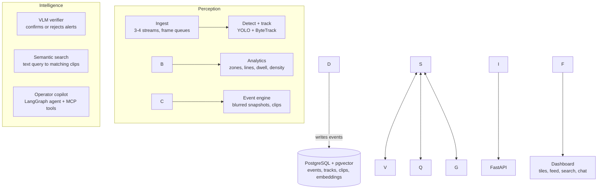

# Basira — Video Intelligence for Smart Cities

> Multi-camera video intelligence: detection, tracking and zone analytics, with VLM-verified alerts, natural-language video search and an agentic operator copilot.

!\[status](https://img.shields.io/badge/status-in%20development-orange)
!\[python](https://img.shields.io/badge/python-3.11-blue)
!\[ci](https://github.com/LostShayar/basira-video-intelligence/actions/workflows/ci.yml/badge.svg)

*Basira* (بصيرة) is Arabic for insight or clear sight.

\---

## Why this project

Most video analytics demos stop at drawing boxes. Real operations teams have a different problem: too many cameras, too many false alarms, and no fast way to answer "what happened at the north gate after 6pm?".

Basira is built in three layers:

1. **Perception** — fast, deterministic computer vision that turns video into structured events.
2. **Intelligence** — an AI layer that verifies alerts, searches footage in plain language and explains incidents.
3. **Product** — an API, a dashboard and an operator copilot, packaged to run with one command.

The core rule: **computer vision produces the facts; the AI layer judges and explains them.** The model never invents what the cameras did not see.

## Architecture



More detail: [docs/architecture.md](docs/architecture.md)

## Features and progress

**v0.1 — Perception**

* \[ ] Multi-stream ingestion (3–4 cameras at once, bounded frame queues)
* \[ ] Person and vehicle detection (Ultralytics YOLO)
* \[ ] Multi-object tracking (ByteTrack)
* \[ ] Polygon zones and line-crossing counts
* \[ ] Dwell-time loitering and crowd density per zone
* \[ ] Face blurring on everything stored

**v0.2 — Events and product**

* \[ ] Event engine with cooldown, snapshots and short clips
* \[ ] PostgreSQL storage
* \[ ] FastAPI endpoints
* \[ ] Streamlit dashboard
* \[ ] One-command Docker Compose stack

**v0.3 — Intelligence**

* \[ ] VLM alert verification, with measured precision before and after
* \[ ] Natural-language video search (CLIP + pgvector)
* \[ ] Incident reports written only from stored facts

**v1.0 — Operator copilot**

* \[ ] LangGraph agent with tools over events and footage
* \[ ] Same tools exposed as an MCP server
* \[ ] Guardrails: read-only database role, checked SQL, logged tool calls

## Results

*Filled in as the project is built.*

|Metric|Value|
|-|-|
|Throughput (4 streams, CPU / GPU)|—|
|Alert precision without VLM verification|—|
|Alert precision with VLM verification|—|
|Median verification latency|—|

## Tech stack

|Layer|Tools|
|-|-|
|Perception|Python, OpenCV, Ultralytics YOLO, ByteTrack, Supervision|
|Storage|PostgreSQL + pgvector|
|Intelligence|Vision-language model (hosted or local via Ollama), CLIP, LangGraph, MCP|
|Product|FastAPI, Streamlit, Docker Compose, Pytest, GitHub Actions|

## Privacy by design

* Faces are blurred in every stored snapshot and clip.
* No face recognition or identity matching.
* Retention limits are set in `configs/cameras.yaml`.
* Only public research datasets are used; their licences are listed below.

## Project structure

```
basira-video-intelligence/
├── basira/
│   ├── ingest/          # multi-stream readers, frame queues
│   ├── perception/      # detector, tracker, face blur
│   ├── analytics/       # zones, lines, dwell, density, speed
│   ├── events/          # event engine, snapshots, clips
│   ├── intelligence/    # VLM verifier, embeddings, reports
│   ├── agent/           # LangGraph copilot, MCP server
│   └── storage/         # database models
├── api/                 # FastAPI app
├── dashboard/           # Streamlit app
├── configs/             # cameras, zones, thresholds
├── eval/                # labelled alerts, benchmarks
├── tests/
└── docs/
```

## Quick start

*Coming in v0.2 — the goal is:*

```bash
git clone https://github.com/LostShayar/basira-video-intelligence.git
cd basira-video-intelligence
cp .env.example .env
docker compose up
```

## Datasets

|Dataset|Used for|Licence|
|-|-|-|
|MOT17 / MOT20|Crowd and pedestrian scenes|Check before use|
|UA-DETRAC|Traffic scenes|Check before use|
|VIRAT|Outdoor surveillance events|Check before use|

Video files and model weights are not stored in this repo. See `scripts/download\_assets.sh`.

## Known limitations

*Documented honestly as they are found.*

## License

MIT — see [LICENSE](LICENSE).

