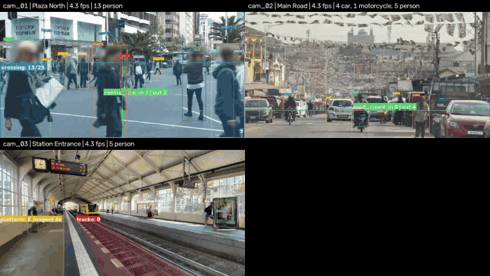
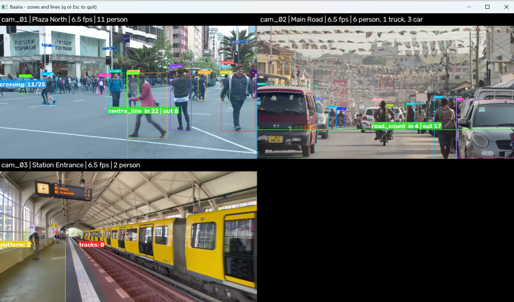
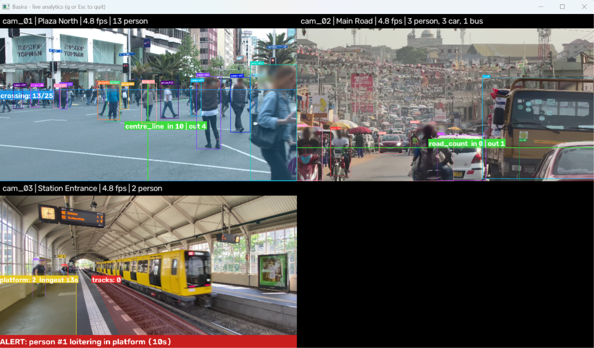
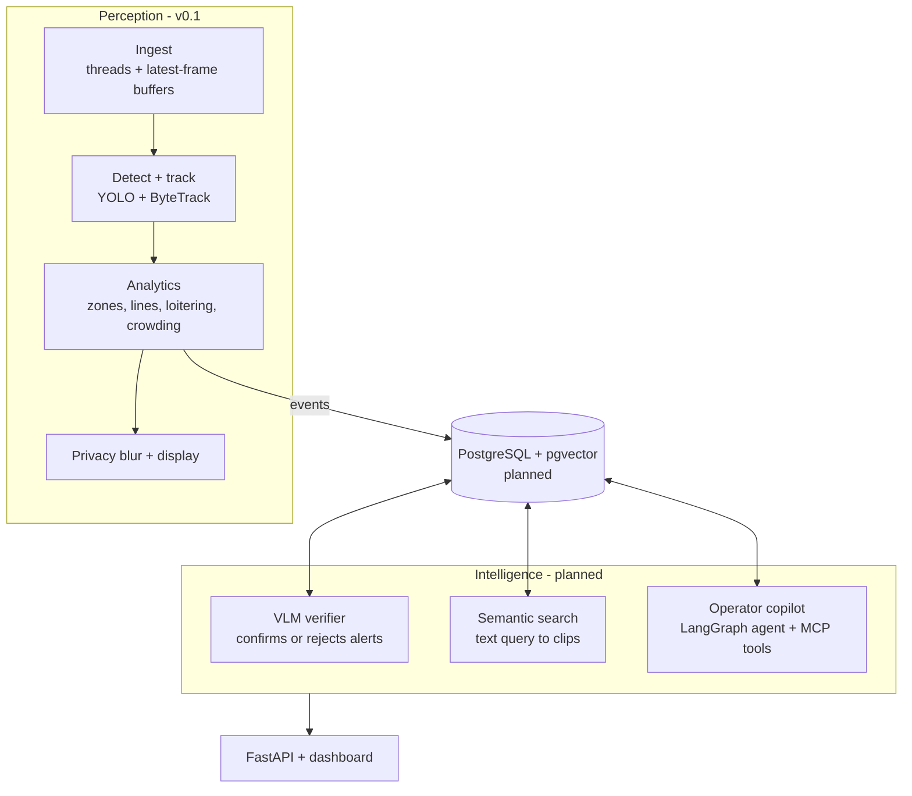

# Basira — Video Intelligence for Smart Cities

> Multi-camera video intelligence: detection, tracking and zone analytics, with VLM-verified alerts, natural-language video search and an agentic operator copilot.


[](https://github.com/LostShayar/basira-video-intelligence/actions/workflows/ci.yml)

*Basira* (بصيرة) is Arabic for insight or clear sight.



---

## Why this project

Most video analytics demos stop at drawing boxes. Real operations teams have a different problem: too many cameras, too many false alarms, and no fast way to answer "what happened at the north gate after 6pm?".

Basira is built in three layers:

1. **Perception** — fast, deterministic computer vision that turns video into structured events. **(v0.1, done)**
2. **Intelligence** — an AI layer that verifies alerts, searches footage in plain language and explains incidents. *(next)*
3. **Product** — an API, a dashboard and an operator copilot, packaged to run with one command. *(next)*

The core rule: **computer vision produces the facts; the AI layer judges and explains them.** The model never invents what the cameras did not see.

## What works today (v0.1)

| Capability | How it works |
| --- | --- |
| Multi-camera ingestion | One reader thread per camera; a latest-frame buffer drops stale frames so latency stays flat; files play at real speed and loop; RTSP streams reconnect |
| Detection | Ultralytics YOLO, one shared model, all cameras sent as a single batch; classes and confidence set in config |
| Tracking | A separate ByteTrack tracker per camera, so every person and vehicle keeps a stable ID |
| Restricted zones | Alert once per entry, using each object's feet position; per-zone class filters (e.g. only people on the tracks) |
| Loitering | Alert when someone stays in a zone longer than its dwell time, once per visit |
| Crowding | Alert when a zone holds more people than its limit, with a cooldown |
| Line counting | In/out counts per direction; each track counted once, jitter on the line ignored |
| Privacy | Head area of every person blurred before frames are shown or recorded; no face recognition or identity matching |
| Config-driven | Cameras, zones, lines and thresholds in one YAML file, with coordinates as fractions of the frame so they fit any resolution |

| Restricted zone and line counting | Loitering alert with privacy blur |
| --- | --- |
|  |  |

## Results

Measured on a laptop CPU (no GPU), 3 camera streams at 720p, YOLO11n at 640 px:

| Metric | Value |
| --- | --- |
| Ingestion only, 3 streams | ~25 fps per camera |
| Full pipeline (detect, track, analytics, draw) | ~7 fps across 3 cameras |
| Unit tests | 35 passing, run in CI on every pull request |
| Line counting, ~4 min live run | plaza 86 in / 43 out, road 28 in / 93 out |
| Loitering | alert fired once per person after the 10 s dwell threshold |

*Coming in v0.3:* alert precision with and without VLM verification, measured on hand-labelled alerts.

## Architecture



More detail: [docs/architecture.md](docs/architecture.md)

## Quick start

Requires Python 3.11 or 3.12.

```bash
git clone https://github.com/LostShayar/basira-video-intelligence.git
cd basira-video-intelligence
python -m venv .venv
source .venv/bin/activate          # Windows (Git Bash): source .venv/Scripts/activate
pip install -r requirements.txt -r requirements-dev.txt
pytest -q                          # 35 tests
```

Put three short videos in `data/` named as in `configs/cameras.yaml` (`plaza_north.mp4`, `main_road.mp4`, `station.mp4`), then:

```bash
python scripts/run_analytics.py                 # live view: q or Esc to quit
python scripts/draw_zones.py --camera cam_03    # click to draw a zone, prints coordinates for the config
```

The YOLO weights (~6 MB) download automatically on the first run.

| Script | What it shows |
| --- | --- |
| `scripts/run_ingest.py` | Multi-camera playback only |
| `scripts/run_tracking.py` | Detection and tracking |
| `scripts/run_analytics.py` | Full pipeline with zones, lines, alerts and privacy blur |
| `scripts/draw_zones.py` | Tool to draw zones and lines |
| `scripts/make_gif.py` | Turn a recording into a README GIF |

## Roadmap

- [x] **v0.1 Perception** — ingestion, detection, tracking, zones, lines, loitering, crowding, privacy blur
- [ ] **v0.2 Events and product** — event engine with snapshots and clips, PostgreSQL, FastAPI, dashboard, Docker Compose
- [ ] **v0.3 Intelligence** — VLM alert verification with measured precision, natural-language video search
- [ ] **v1.0 Operator copilot** — LangGraph agent over events and footage, exposed as an MCP server, with guardrails

## Project structure

```
basira-video-intelligence/
├── basira/
│   ├── config.py        # loads configs/cameras.yaml
│   ├── pipeline.py      # detect -> track -> analytics -> privacy -> draw
│   ├── ingest/          # stream.py, buffer.py, tiling.py
│   ├── perception/      # detector.py, tracker.py, annotate.py, privacy.py
│   ├── analytics/       # zones.py, draw.py
│   ├── events/          # planned: event engine, snapshots, clips
│   ├── intelligence/    # planned: VLM verifier, embeddings, reports
│   ├── agent/           # planned: copilot, MCP server
│   └── storage/         # planned: database models
├── configs/cameras.yaml # cameras, zones, lines, thresholds
├── scripts/             # runnable demos and tools
├── tests/               # 35 unit tests
├── docs/
└── .github/workflows/   # CI
```

## Privacy by design

- The head area of every detected person is blurred before frames are shown or recorded.
- No face recognition or identity matching, now or planned.
- Retention limits are set in `configs/cameras.yaml`.
- Only public sample footage is used for development.

## Known limitations

- Runs at ~7 fps across 3 cameras on CPU; a GPU or an exported ONNX/TensorRT model would be needed for more cameras.
- Zone placement is manual per camera (a click tool helps).
- Head-area blur is approximate: it covers the top of each person's box, so unusual poses can leave part of a face visible.
- Tested on recorded public clips, not live city cameras.

## License

MIT — see [LICENSE](LICENSE).
